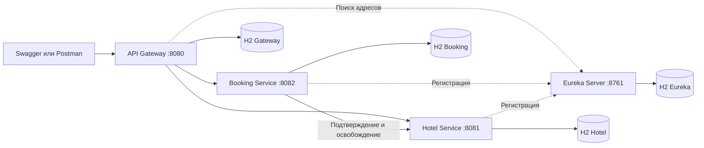

# Система бронирования отелей


<br>


<br>

[](https://github.com/yuyuvu/springhotelsbookingapp/actions/workflows/ci.yml)

## О проекте

Это backend-проект для бронирования номеров в отелях. Пользователь может зарегистрироваться, войти в аккаунт, посмотреть свободные номера, создать бронирование, изменить его или отменить, а также посмотреть свою историю. Администратор может управлять отелями, номерами и пользователями, просматривать статистику загрузки.
<br>
Проект написан на Java 21 с использованием Spring Boot 4.1.2 и Spring Cloud. Реализованы четыре самостоятельных Spring Boot приложения: API Gateway, Hotel Service, Booking Service и Eureka Server. У каждого приложения своя база данных H2, работающая в оперативной памяти. Взаимодействие между приложениями осуществляется через HTTP.
<br>
Дополнительно реализованы автоматический подбор номера с равномерной загрузкой, корректная обработка одновременных запросов, защита от повторного создания одной брони и отмена брони занятого интервала при ошибке связи между сервисами. Весь проект вместе с автоматическими проверками запускается одной командой Docker Compose.

## Возможности системы

1) Регистрация обычных пользователей и вход по логину и паролю с получением JWT-токена на один час.
2) Просмотр отелей, поиск по названию, получение отдельного отеля по id, сортировка и вывод результатов по страницам.
3) Просмотр номеров, свободных на заданные даты, с возможностью ограничить поиск одним отелем.
4) Создание брони с выбором конкретного номера или автоматическим подбором по нагрузке.
5) Просмотр своей отдельной брони и истории с фильтрами по статусу и датам.
6) Изменение подтверждённой брони до заезда. Прежний интервал сохраняется до успешного подтверждения нового.
7) Отмена своей брони с освобождением номера. Повторная отмена безопасна.
8) Создание, чтение, изменение и удаление отелей, номеров и пользователей администратором. При удалении сохраняется история по связанным записям.
9) Подсчёт занятых ночей и процента загрузки за 30 календарных дней для номера и всего отеля.
10) Обработка сетевых ошибок, таймаутов и потерянных ответов с повторными попытками и восстановлением незавершённых действий в фоне.
11) Проверка ролей и принадлежности бронирования пользователю. Каждый сервис самостоятельно проверяет JWT.
12) Наличие документации API через Swagger, формируются сообщения об ошибках и логи в формате JSON с общим идентификатором запроса.

## Используемые инструменты и библиотеки

1) Java 21.
2) Spring Boot 4.1.2, Spring MVC и Spring WebFlux для запуска приложений и обработки запросов.
3) Spring Cloud 2025.1.4, Eureka и Spring Cloud LoadBalancer для регистрации приложений и поиска их адресов.
4) Spring Cloud Gateway для маршрутизации запросов через общий адрес.
5) Spring Security и OAuth2 Resource Server для проверки JWT и ограничения доступа.
6) Spring Data JPA и Hibernate для работы с данными, H2 для отдельных баз в памяти.
7) Flyway для создания таблиц и загрузки демонстрационных данных при запуске.
8) Resilience4j 2.4.0 для повторов сетевых вызовов и ограничения обращений при сбоях.
9) Lombok 1.18.48 и MapStruct 1.6.3 для сокращения шаблонного кода и преобразования объектов в данные запросов и ответов.
10) springdoc-openapi 3.2.0 для OpenAPI и Swagger UI.
11) SLF4J и Logback для логирования.
12) JUnit, Mockito, MockMvc и WebTestClient для тестов, JaCoCo для отчётов о покрытии тестами.
13) Maven 3.10.0 для сборки, Spotless 3.10.4 и google-java-format 1.36.1 для автоматического форматирования стиля кода.
14) Docker и Docker Compose для запуска проекта с готовыми настройками.

## Структура проекта

Каждое из четырёх приложений имеет собственный pom.xml, Maven Wrapper, Dockerfile, настройки, тесты и точку входа. Их можно собирать по отдельности. Общего корневого Maven-проекта и обязательной сборки соседних сервисов нет.
<br>
Основные директории:

1) discovery-server - реестр Eureka. Хранит адреса работающих приложений и позволяет сервисам находить друг друга.
2) api-gateway - одна точка доступа к API. Он проверяет JWT-токен, направляет запрос в нужный сервис и передаёт идентификатор запроса.
3) hotel-service - отвечает за отели, номера, календарь занятости номеров, автоматический подбор и статистику.
4) booking-service - отвечает за работу с пользователями, выпуск токенов, бронирования, согласование подтверждения и отмены с сервисом отелей.
5) system-tests - отдельный Maven-проект для запуска интеграционных Java-тестов. При запуске Compose он запускается и работает в отдельном контейнере integration-tests.
6) .github/workflows - автоматическая сборка и проверки через GitHub Actions.

Внутри приложений код сервисов разделён на пакеты:

- entities - сущности, соответствующие данным в таблицах.
- repositories - чтение и изменение данных через JpaRepository, запросы и блокировки записей.
- services - интерфейсы бизнес-операций приложения, services.impl - их реализации.
- controllers - обработка HTTP-запросов и описания моделей данных для запросов и ответов.
- security - проверка доступа, работа с токенами и паролями.
- config - настройка компонентов приложения.
- support - общие для конкретного приложения проверки дат, обработка ошибок, преобразование данных и прочие вспомогательные методы.
- client в Booking Service - интерфейс обращения к отелю и его HTTP-реализация.

<br>
Зависимости передаются через конструкторы. Основная логика находится в сервисах, для которых предусмотрены интерфейсы и реализации с суффиксом Impl. Контроллеры работают с отдельными DTO запросов и ответов, преобразование выполняется при помощи MapStruct. Код в Java-файлах подробно задокументирован.

## Архитектура приложения

Пользователь отправляет запросы на общий адрес Gateway. Шлюз узнаёт адрес нужного сервиса через Eureka. Booking Service обращается к Hotel Service для занятия и освобождения дат для отдельного номера. Каждый сервис работает только со своей базой.



Порты 8081 и 8082 используются только внутри Docker-сети. Напрямую доступны Gateway на порту 8080 и Eureka на порту 8761.

## Запуск проекта

Для запуска нужны работающий Docker Engine и Docker Compose. Все настройки, демонстрационные ключи и демонстрационные данные уже включены в проект.

1) Скачайте или клонируйте репозиторий и перейдите в корневую папку проекта.
2) Выполните команду:

```bash
docker compose up --build --wait --wait-timeout 300
```

3) Дождитесь завершения сборки, завершения выполнения тестов и ожидания готовности приложений (потребуется около 5 минут). При первой сборке дополнительно скачиваются Docker образы и зависимости Maven.

Во время сборки выполняются отдельные тесты для каждого приложения и проверка стиля кода по google-java-format. Контейнер integration-tests запускает интеграционные тесты, после их успешного завершения становится доступен Gateway. Состояние Exited (0) у integration-tests означает, что проверки завершились успешно. После этого четыре микросервиса продолжают работать и готовы к использованию.
<br>
После запуска доступны следующие адреса:

- http://localhost:8080/swagger-ui/index.html - Swagger UI с выбором Booking Service и Hotel Service.
- http://localhost:8080/docs/booking - описание в формате OpenAPI сервиса бронирования.
- http://localhost:8080/docs/hotel - описание в формате OpenAPI сервиса отелей.
- http://localhost:8080/actuator/health/readiness - проверка готовности системы.
- http://localhost:8761 - реестр Eureka. Логин eurekalogin, пароль eurekapassword.

Для обычного запуска локальные Java и Maven не нужны. Приложения собираются внутри Docker. Отдельно запускать Swagger или загружать данные тоже не требуется.
<br>
Остановка проекта:

```bash
docker compose down
```

По условию проекта, базы H2 работают в памяти. После остановки процессов внесённые изменения теряются, при следующем запуске через миграции снова загружаются исходные данные. Перезапускать систему для сброса данных нужно целиком, чтобы брони Booking и календарь Hotel оставались согласованы.

## Демонстрационные данные

При запуске Flyway создаёт таблицы и загружает пользователей, отели, номера и бронирования. Для проверки можно сразу войти под одной из готовых учётных записей:

1) user1, пароль user1password, роль USER.
2) user2, пароль user2password, роль USER.
3) admin, пароль adminpassword, роль ADMIN.

Добавлены два отеля, по семь номеров в каждом:

1) "Хороший отдых", Москва. Номера: 59, 45, 49, 58, 67, 81, 88. Номер 81 недоступен для проживания.
2) "Премиум отель", Казань. Номера: 6002, 6011, 6124, 6338, 6507, 6801, 6992. Номера 6507 и 6992 недоступны.

В первом отеле внутренние id номеров идут от 1 до 7 в указанном порядке, во втором - от 8 до 14. Например, roomId=3 соответствует номеру 49, roomId=9 - номеру 6011. В запросах бронирования передаётся внутренний id. У некоторых номеров выставлены нулевые значения счётчика бронирований.
<br>
Также загружаются четыре подтверждённые брони. Относительно даты первоначального запуска по UTC:

1) user1, roomId=1, номер 59: заезд 24 дня назад, выезд 20 дней назад, 4 ночи.
2) user2, roomId=2, номер 45: заезд 16 дней назад, выезд 13 дней назад, 3 ночи.
3) user1, roomId=8, номер 6002: заезд 9 дней назад, выезд 7 дней назад, 2 ночи.
4) user2, roomId=10, номер 6124: заезд 3 дня назад, выезд на следующий день после первоначального запуска, 4 ночи.

В обеих базах уже есть соответствующие записи, поэтому можно сразу посмотреть историю и статистику. Изначально всего 14 номеров, 3 недоступны, сумма счётчиков бронирований равна 4.

## Проверка работоспособности через Swagger

1) Откройте http://localhost:8080/swagger-ui/index.html и выберите Booking Service в списке сверху.
2) В методе POST /api/auth/login нажмите Try it out и отправьте:

```json
{
  "username": "user1",
  "password": "user1password"
}
```

3) Скопируйте accessToken из ответа. Нажмите сверху страницы Authorize и вставьте токен без слова Bearer: Swagger добавит его сам.
4) Выполните GET /api/bookings. Для user1 будут видны две исходные брони. Если войти под user2, отобразятся его брони.
5) Переключитесь сверху на Hotel Service и заполните тот же Authorize для этого сервиса. Посмотрите GET /api/hotels, затем GET /api/rooms/recommend с будущими датами для startDate и endDate (в формате ГГГГ-ММ-ДД).
6) Вернитесь к Booking Service и отправьте POST /api/bookings. Пример тела запроса:

```json
{
  "requestId": "76895b1b-3c7b-4df3-90b1-1e45ecae7491",
  "autoSelect": true,
  "hotelId": 1,
  "startDate": "2027-02-10",
  "endDate": "2027-02-12"
}
```

Перед проверкой замените даты будущими относительно текущего дня. Для каждого нового действия создавайте новый UUID в requestId. При autoSelect=true номер (комната) выбирается автоматически в указанном отеле; поле roomId игнорируется. Для ручного выбора передайте autoSelect=false и, например, roomId=3.
<br>
При успешном создании возвращаются код 201, id бронирования и статус CONFIRMED. Если обработка ещё выполняется, возможен ответ 202 с заголовком Location. В этом случае повторяйте исходный запрос с тем же ключом до получения окончательного результата.

7) Повторите тот же запрос с тем же requestId. Должен вернуться сохранённый результат без второй брони. Если изменить параметры и оставить прежний ключ, вернётся ошибка 409.
8) Полученный id подставьте в GET /api/bookings/{id}. Для изменения отправьте PATCH по этому же адресу с новым requestId и новыми параметрами. Для отмены отправьте DELETE по id из ответа. Повторный DELETE безопасен.
9) Для проверки занятых дат создайте две ручные брони на один номер и пересекающиеся периоды с разными ключами. Вторая бронь должна получить отказ 409. При выезде одного пользователя и заезде другого в один день пересечения нет.
10) Войдите как admin с паролем adminpassword. Проверьте административные операции с отелями, номерами и пользователями (помечены ADMIN в описании в openapi). GET /api/admin/rooms покажет также недоступные номера (с полем available = false). Статистику можно посмотреть через GET /api/rooms/1/statistics и GET /api/hotels/1/statistics. Поля, которые возвращаются в ответе статистики, описаны далее в README.

Для проверки через Postman используйте адрес http://localhost:8080 и передавайте токен в заголовке Authorization: Bearer токен. Готовые тела запросов и описания полей доступны в Swagger.

## Описание API

Базовый адрес: http://localhost:8080.
<br>
Данные запросов и ответов передаются в формате JSON. Описание эндпойнтов и моделей запросов и ответов открывается в Swagger. Основные коды ответов перечислены ниже.

### Регистрация и вход

Методы доступны без токена:

- POST /api/auth/register - регистрация обычного пользователя. Тело: { "username": "newuser1", "password": "newuser1password" }.
- POST /api/auth/login - вход по логину и паролю. В ответе возвращаются accessToken, tokenType, expiresIn и данные пользователя.

При регистрации выдаётся только роль USER. Имя содержит от 3 до 80 латинских букв, цифр или символов подчёркивания, точки и дефиса. Длина пароля при регистрации от 10 до 72 символов.

### Бронирования

Методы доступны вошедшим пользователям и администратору. Работа с отдельной бронью и историей доступна для их владельца:

- POST /api/bookings - создать бронирование с ручным или автоматическим выбором номера.
- GET /api/bookings - получить страницу своей истории.
- GET /api/bookings/{id} - получить свою бронь.
- PATCH /api/bookings/{id} - изменить свою подтверждённую бронь до начала проживания. Тело имеет тот же формат, что и создание, с новым requestId.
- DELETE /api/bookings/{id} - отменить свою бронь.
- GET /api/bookings/recommendations - получить свободные номера через Booking Service. Обязательны startDate и endDate, hotelId можно указать дополнительно.

Для новой брони дата заезда должна быть сегодняшней или будущей. Выезд позже заезда, длительность от 1 до 366 ночей. Даты передаются в формате ГГГГ-ММ-ДД.
<br>
История поддерживает status, from и to для фильтрации по статусу и дате заезда. Параметры страницы: page с нуля, size от 1 до 100, sort в виде createdAt,desc. Разрешены сортировки по id, createdAt, startDate, endDate и status.
<br>
Заголовок Idempotency-Key нужен для того, чтобы сервис мог распознать повторную отправку одного и того же запроса. Например, если ответ на создание брони потерялся из-за проблем с сетью, можно отправить тот же запрос с прежним ключом и получить результат без создания второй брони. Для нового действия нужен новый ключ.
<br>
Вместо requestId в теле можно передавать заголовок Idempotency-Key. Если указаны оба значения, они должны совпадать. Повтор исходного успешного POST возвращает его сохранённый результат, даже если бронь уже была отменена позднее. Текущее состояние показывает GET.

### Отели

- GET /api/hotels - список действующих отелей с поиском search, сортировкой sort и параметрами page, size.
- GET /api/hotels/{id} - сведения об одном отеле.
- POST /api/hotels - добавить отель, только ADMIN.
- PATCH /api/hotels/{id} - изменить название и адрес, только ADMIN.
- DELETE /api/hotels/{id} - перенести отель и его номера в архив, только ADMIN.
- GET /api/hotels/{id}/statistics - статистика загрузки отеля, только ADMIN.

Тело для создания и изменения: { "name": "Название отеля", "address": "Город, улица, дом" }. Поиск осуществляется по названию, сортировка доступна по id, name и address.

### Номера

- GET /api/rooms - свободные номера на период. Обязательны startDate и endDate, hotelId необязателен.
- GET /api/rooms/recommend - те же свободные номера с оценкой нагрузки и рангом автоматического выбора.
- GET /api/rooms/{id} - сведения об одном номере.
- POST /api/rooms - добавить номер, только ADMIN.
- PATCH /api/rooms/{id} - изменить число номера и операционную доступность, только ADMIN.
- DELETE /api/rooms/{id} - перенести номер в архив, только ADMIN.
- GET /api/admin/rooms - получить страницу всех неархивных номеров, включая недоступные, только ADMIN.
- GET /api/rooms/{id}/statistics - статистика отдельного номера, только ADMIN.

Тело для создания и изменения: { "hotelId": 1, "number": "75", "available": true }. Перенос существующего номера в другой отель запрещён. Пометить номер операционно недоступным или убрать в архив можно при отсутствии текущих и будущих бронирований.
<br>
Административный список поддерживает фильтры hotelId и available, параметры page, size, sort. Сортировка доступна по id, number, timesBooked и hotelId.

### Пользователи

Все методы этого раздела доступны только ADMIN:

- POST /api/users - создать пользователя с заданной ролью.
- GET /api/users - получить страницу пользователей с page, size и sort по id, username или createdAt.
- GET /api/users/{id} - получить данные пользователя без пароля.
- PATCH /api/users/{id} - изменить имя, роль и при необходимости пароль.
- DELETE /api/users/{id} - деактивировать учётную запись.

Пример тела: { "username": "newuser2", "password": "newuser2password", "role": "USER" }. При изменении пароль можно пропустить. Последнего активного администратора нельзя удалить или лишить роли. Пользователя с действующими бронированиями деактивировать нельзя.

### Дополнительные совместимые пути

Поддерживаются также дубли путей, требуемые по условию: POST /user/register, POST /user/auth, POST /user, PATCH /user, DELETE /user, POST /booking, GET /bookings, GET /booking/{id}, PATCH /booking/{id} и DELETE /booking/{id}.
<br>
Они используют ту же логику и проверки доступа, как и их ранее описанные дубли. В PATCH /user идентификатор id передаётся в теле, в DELETE /user - параметром запроса.

### Внутренние операции между сервисами

Эти методы вызываются Booking Service со служебным токеном. Через Gateway они закрыты и в Swagger не отображаются:

- POST /api/rooms/{id}/confirm-availability - проверить доступность выбранного номера и удержать указанный интервал дат.
- POST /api/rooms/{id}/release - освободить бронь, когда номер известен. Тело содержит bookingId.
- POST /internal/reservations - выбрать и занять номер, в том числе при автоподборе.
- POST /internal/reservations/{bookingId}/release - освободить всю бронь, если после потери ответа выбранный номер неизвестен.
- POST /internal/operations/{operationId}/commit - отметить удержанный интервал подтверждённым для статистики.
- POST /internal/operations/{operationId}/release - освободить отдельную операцию, например после неудачного изменения брони.

### Ошибки запросов

Выводятся собственные сообщения об ошибках и валидации. Формат ответа унифицирован: type, title, status, code, detail, instance, timestamp, traceId и errors. В errors передаются замечания к полям. При ошибке создания брони там дополнительно находятся bookingId, bookingStatus и compensationPending, показывающий, ожидается ли ещё освобождение номера.
<br>
Основные коды ответа:

- 400 - некорректные данные, даты или параметры запроса.
- 401 - токен отсутствует, неверен или просрочен.
- 403 - недостаточно прав для операции.
- 404 - запись не найдена либо запрошена чужая бронь.
- 409 - занятые даты, конфликты с ключами или одновременное изменение.
- 413 - тело запроса превышает разрешённый размер.
- 503 - сервис отелей недоступен или отклонил вызов.
- 504 - истекли время ожидания сервиса отелей или срок подтверждения брони.

## Алгоритм подтверждения бронирования

Создание брони затрагивает две самостоятельные базы. Поэтому нами реализована последовательность отдельных транзакций с отменой при ошибке:

1) Booking Service проверяет пользователя, корректность дат и ключ запроса. При изменении дополнительно проверяет состояние и владельца брони. Сохраняет бронь со статусом PENDING и запись операции, затем завершает локальную транзакцию.
2) После сохранения отправляет запрос в Hotel Service. Во время ожидания по сети блокировки базы Booking не удерживаются.
3) Hotel Service проверяет свободность дат по своему календарю, при необходимости выбирает номер, сохраняет удержание интервала дат для номера и увеличивает счётчик бронирований в своей транзакции.
4) При успешном ответе Booking переводит ожидающую бронь в CONFIRMED. Отдельным внутренним вызовом Hotel получает отметку подтверждения для статистики.
5) При ошибке или истечении срока Booking переводит новую бронь в CANCELLED и сохраняет задание освобождения номера. Освобождение выполняется также после таймаута, так как Hotel мог успеть занять даты и потерять ответ.
6) Если освобождение временно недоступно, задание остаётся в базе. Фоновый обработчик повторяет попытки после восстановления связи.

Таким образом, реализованы паттерны саги и компенсации. Для проверки занятости Hotel использует собственную таблицу reservations, связанную с операциями бронирования.
<br>
Для удалённых вызовов заданы таймаут соединения 500 мс и ожидания ответа 1500 мс. Максимум 3 попытки, интервал увеличивается и содержит небольшую случайную величину, чтобы повторы разных запросов меньше совпадали. Срок подтверждения операции составляет 15 секунд.
<br>
Через Resilience4j реализованы паттерны отказоустойчивости Retry, CircuitBreaker и Bulkhead. Они ограничивают повторы, временно останавливают вызовы при частых ошибках и ограничивают число одновременных обращений. Для освобождения номеров используется отдельный CircuitBreaker, чтобы сбои подтверждения не мешали отменам.
<br>
Повтор определяется по пользователю и requestId. Сохраняется контрольное значение параметров запроса. Отправка одинаковых запросов приводит к получению того же уже сохранённого результата; изменение параметров с прежним ключом запроса приводит к статусу 409.
<br>
Отмена имеет преимущество перед поздним успешным ответом. В Hotel сохраняется отметка об отмене брони, которая запрещает последующее занятие дат. Освобождение уменьшает счётчик броней один раз. При изменении брони старый интервал остаётся до подтверждения нового; неудачное изменение освобождает только новую операцию. Полная отмена освобождает все варианты брони.

## Алгоритм автоматического подбора номера

В проекте реализован улучшенный подбор по реальной статистике нагрузки номера с учётом истории бронирований. Сначала из кандидатов исключаются архивные, операционно недоступные и занятые на выбранные даты номера.
<br>
Для каждого оставшегося номера рассчитывается показатель loadNights:

```text
loadNights = occupiedNights30 + heldNights30 + upcomingArrivalNights
```

occupiedNights30 - подтверждённые ночи за последние 30 календарных дней, включая сегодня. heldNights30 - временно удержанные ночи в том же периоде. upcomingArrivalNights - все ночи активных броней с заездом начиная с завтра и до 120-го дня включительно.
<br>
В будущей части важна дата заезда. Если бронь начинается на 120-й день и заканчивается на 125-й, учитываются все пять ночей. Заезд на 121-й день или через два года сюда не попадает. Дата создания такой брони значения не имеет. У уже начавшегося проживания учитываются ночи в первом параметре occupiedNights30, оставшиеся будущие ночи в upcomingArrivalNights не добавляются.
<br>
Также считается recentBookings - количество неотменённых бронирований, принятых за последние 30 календарных дней. Это дополнительный критерий при одинаковом числе ночей по показателю loadNights.
<br>
Номера сравниваются последовательно:

1) По loadNights, по возрастанию.
2) При равенстве ночей по recentBookings, тоже по возрастанию.
3) При равенстве первых двух показателей по накопленному timesBooked (количество бронирований за всё время).
4) При полном равенстве по id.

Номера сравниваются по этим показателям, а затем им присваивается allocationRank. Ранг 1 имеет наиболее предпочтительный номер для автоподбора. Ранг рассчитывается среди кандидатов для текущего запроса, отдельно в базе не хранится.
<br>
Рекомендации обоих сервисов возвращаются с сортировкой по timesBooked и затем по id, как требуется по условию. Но вместе с каждым номером также передаются allocationRank и allocationLoad. Поэтому первый номер в списке рекомендаций может иметь другой ранг. Автоматический подбор использует именно allocationRank (а не позицию в ответе после сортировки) и каждый раз пересчитывает его во время занятия номера.
<br>
Таким образом, при добавлении новых номеров старым не требуется ждать выравнивания всех накопленных бронирований. Например, номер с 1000 имеющихся броней и нагрузкой в 1 ночь получит преимущество перед новым номером с нагрузкой в 4 ночи. В тестах есть два старых номера с 1000 имеющихся броней у каждого и десять новых: первые 12 новых одинаковых по длительности назначений используют все 12 номеров.
<br>
Проверка дат, выбор, сохранение удержания и изменение счётчика выполняются под блокировкой room_lock в одной транзакции Hotel. Следующий параллельный запрос видит уже изменившуюся нагрузку. Данные для расчёта читаются сразу по всем кандидатам. Временные удержания учитываются при выборе сразу, отменённые записи исключаются.
<br>
Бронь занимает интервал от startDate включительно до endDate исключительно. День выезда свободен для следующего заезда. Поле available отвечает за общую операционную доступность или недоступность номера, например, недоступность в случае длительного ремонта. Занятость по конкретным датам проверяется в Hotel Service по таблице reservations.
<br>

## Статистика загрузки

Статистика доступна администратору по /api/rooms/{id}/statistics и /api/hotels/{id}/statistics. По умолчанию берутся последние 30 календарных дней, включая сегодняшний. Ответ содержит startDate, endDate и periodNights=30.
<br>
Можно передать startDate, тогда конец будет через 30 дней; можно передать только endDate или обе границы. При двух границах длина периода должна равняться 30 дням, иначе вернётся ошибка 400.
<br>
Процент загрузки номера = число подтверждённых занятых ночей / 30 * 100. Процент загрузки отеля = подтверждённые ночи всех его номеров / (число неархивных номеров * 30) * 100. Операционно недоступные номера включаются в общий фонд номеров отеля для статистики. idleRoomCount показывает число номеров без подтверждённых ночей за период.
<br>
Временные удержания выводятся отдельно в reservedNights. Ночи обрезаются границами отчёта. timesBooked показывает число принятых неотменённых бронирований за всё время. Показатели allocationLoad используются для подбора и рассчитываются по своим правилам, описанным выше.

## База данных

Структура базы данных создаётся автоматически через Flyway. SQL-миграции структуры находятся в src/main/resources/db/migration у Hotel Service и Booking Service. Миграции демонстрационных данных - в src/main/java/db/demo этих сервисов. Hibernate проверяет готовую структуру через ddl-auto=validate.
<br>
В Booking Service создаются таблицы:

1) users - id, уникальное имя username, хеш password, role, active, created_at и version.
2) bookings - id брони, user_id, room_id, hotel_id, даты start_date и end_date, status, created_at, updated_at, current_operation, pending_operation и version.
3) booking_operations - отдельные запросы создания и изменения броней: id, booking_id, user_id, request_id, fingerprint, kind, state, action, выбранный номер и отель, даты, previous_operation, сроки обработки, attempts, ошибка и trace_id. Пара user_id и request_id уникальна.
4) user_lock - строка блокировки для защиты последнего активного администратора от удаления.

В Hotel Service создаются таблицы:

1) hotels - id, name, address, archived и version.
2) rooms - id, hotel_id, number, available, times_booked, archived и version. Номера уникальны внутри отеля, счётчик номера не может стать отрицательным.
3) reservations - id операции, booking_id, room_id, start_date, end_date, state, confirmed, fingerprint и created_at. Здесь сохраняются интервалы календаря и результаты их освобождения.
4) cancelled_bookings - идентификаторы отменённых броней для запрета брони в случае позднего подтверждения.
5) room_lock - строка блокировки для корректной работы параллельных операций проверки и изменения календаря.

Связи пользователя с бронями и отеля с номерами защищены внешними ключами внутри собственных баз. room_id и hotel_id в Booking являются внешними идентификаторами. Прямого чтения таблиц других сервисов нет.
<br>
Добавлены индексы для истории пользователя, поиска свободных номеров, пересечения дат и др.

## Принятые архитектурные решения (ADR)

### 1. Четыре самостоятельных приложения

По условию каждому сервису требуется собственное Spring Boot-приложение с H2. Для этого у каждого проекта отдельные настройки сборки и запуска, своя точка входа и база данных. Общая сборка через Docker Compose объединяет готовые приложения. Такой подход позволяет отдельно проверять и дорабатывать любой сервис.

### 2. Дополнительный календарь reservations в сервисе отелей

Booking Service хранит основное состояние бронирования. Hotel Service при этом должен уметь подтверждать доступность номера, доступность дат для отдельного номера, снимать удержания в собственной транзакции, а также иметь возможность предоставлять расширенную статистику и аналитику. Поэтому мы дополнительно сохраняем в Hotel отдельные записи календаря reservations, связанные с bookingId и operationId.
<br>
Это позволяет одновременно проверить пересечение дат, занять номер и изменить счётчик внутри одной базы. Также локально доступны данные для аналитики: подтверждённые ночи, удержания, нагрузка, без обратного обращения к Booking Service и чтения его базы данных. Согласование календаря с Booking выполняют уведомления-подтверждения и компенсации. Такое решение добавляет необходимость обрабатывать временное расхождение сервисов, что выполняется при помощи фонового обработчика, работающего с сохранёнными заданиями и повторами операций.

### 3. Окончательный выбор номера в Hotel Service

Booking инициирует подбор и возвращает рекомендации пользователю. Окончательный выбор выполняется в Hotel под общей блокировкой, так как предварительно прочитанный список может устареть при параллельных запросах. Общая блокировка подходит текущему приложению с одним экземпляром базы данных H2 Hotel. Однако масштабирование на несколько экземпляров базы может потребовать другого способа согласования операций.
<br>
Расчёт нагрузки и занятие дат при автоподборе выполняются вместе. Рекомендации номеров приходят в ответе с сортировкой по счётчику бронирований за всё время, но автоподбор осуществляется по значению показателя allocationRank (реальную нагрузку). Рекомендации содержат справочно это поле allocationRank для каждого номера. При автоматическом бронировании Hotel Service заново рассчитывает ранг и выбирает номер в одной транзакции с проверкой и занятием дат. Это позволяет выполнить требование к формату ответа рекомендаций и избежать неравномерной нагрузки при автоподборе.

### 4. Использование локальных транзакций и сохранённых заданий фонового обработчика

Распределённая общая транзакция между двумя базами не используется. Booking фиксирует PENDING до коммуникации по сети и отдельно сохраняет результат после ответа. Отдельная запись в booking_operations содержит следующее действие, срок, число попыток и время следующего выполнения. Фоновый обработчик продолжает незавершённые действия.
<br>
При известном roomId освобождение выполняется через POST /api/rooms/{id}/release. Дополнительный путь, использующий bookingId, нужен на случай потери ответа при автоподборе, когда выбранный номер неизвестен. Подтверждённый интервал сохраняется до явной отмены или замены. Время жизни заданий для фонового обработчика ограничено временем жизни базы H2 в памяти.

### 5. Разделение пользовательского и служебного доступа

Токен пользователя подходит для внешнего API. Для занятия и освобождения номеров Booking выпускает отдельный служебный токен. Это позволяет закрыть доступ к внутренним действиям даже от пользователя с ролью ADMIN. Gateway блокирует доступ к служебным путям, Hotel дополнительно проверяет полномочия самостоятельно.

### 6. Сохранение истории при удалении

Удаление пользователя означает деактивацию, удаление отеля или номера - перенос в архив. Записи остаются в базе для истории и связанных бронирований, действующие списки учитывают эти признаки. Также проверяется отсутствие текущих и будущих броней перед архивированием номера.

### 7. Отдельный запуск интеграционных тестов

Для проверки проекта достаточно одной команды Docker Compose. Тесты отдельных сервисов выполняются при сборке их образов. Интеграционные тесты взаимодействия между сервисами запускаются автоматически в отдельном контейнере со своими процессами приложений и отдельными базами H2. Это позволяет провести все необходимые тесты взаимодействия микросервисов, сохраняя нетронутыми демонстрационные данные приложения и не влияя на его работу. Swagger запускается вместе с сервисами.

## Безопасность

Пароли сохраняются в виде хеша BCrypt. После регистрации или входа пользователь получает JWT на 3600 секунд. Токен подписывается через алгоритм RS256, закрытый ключ находится только в Booking. Gateway и рабочие сервисы самостоятельно проверяют подпись, срок, издателя и назначение токена. В Eureka настроена проверка JWT, доступ к реестру осуществляется по отдельным служебным логину и паролю.
<br>
USER работает со своими бронированиями. ADMIN управляет отелями, номерами, пользователями и смотрит статистику. Администратор тоже может пользоваться личными бронированиями, его пользовательская история ограничена собственными записями. Владелец определяется по sub токена, активность учётной записи дополнительно проверяется в Booking. Ограничения ролей заданы в том числе через @PreAuthorize для отдельных методов.
<br>
Внутренний служебный JWT действует две минуты и имеет назначение hotel-internal, token_use=service и разрешение inventory.write. Токены пользователей не дают таких полномочий. В проекте есть готовые демонстрационные ключи и пароли для проверки. Распределённый отзыв JWT пользователей не реализован, он перестаёт действовать с истечением срока действия.

## Тестирование

В проект добавлено 54 автоматических теста: Hotel Service - 21, Booking Service - 23, Gateway - 4, Eureka - 1, интеграционные тесты - 5. Используются JUnit, Mockito, MockMvc и WebTestClient. Проверки календаря и конкурентных операций работают с настоящей H2. Покрытие тестами 4 микросервисов по отчётам JaCoCo составляет более 75% у каждого из четырёх микросервисов.
<br>
Основные классы тестов:

1) InventoryIntegrationTest - проверка работы с отелями и номерами, правами доступа, датами, повторами, отменами до позднего подтверждения, проверка конкурентного занятия одного номера, равномерного подбора, подбора для старых и новых номеров, проверки присвоения ранга по нагрузке и статистики.
2) BookingSagaIntegrationTest - сохранение PENDING до удалённого вызова, подтверждение, отказ, таймаут, повтор запроса, изменение, отмена, принадлежность брони и восстановление освобождения.
3) HotelHttpClientTest - реальные HTTP-обращения к тестовому серверу, ограниченные повторы, проверка статуса 409, таймауты, отдельная защита освобождения слота и выбор нужного пути release.
4) GatewayIntegrationTest - маршруты, JWT, передача идентификатора запроса.
5) RegistryIntegrationTest - проверка готовности реестра Eureka.
6) DistributedBookingTest - отдельные процессы Booking и Hotel, ошибки 503, потерянный успешный ответ, задержанное подтверждение после отмены, временный отказ освобождения слота и проверка конкурентных запросов.
7) GatewaySystemTest - проверка всего пути различных операций через Gateway.

При обычном запуске через Docker Compose все эти проверки уже выполняются. Ошибка теста прерывает сборку либо не позволяет запустить Gateway. Результат интеграционных тестов можно посмотреть командой:

```bash
docker compose logs integration-tests
```

Для ручного тестирования отправляйте запросы через Swagger или Postman по адресу http://localhost:8080. Опирайтесь на описание API и примеры выше. Можно проверить вход с разными ролями, запрет на просмотр чужой брони, занятие одного номера на пересекающиеся даты, повтор одинакового запроса и повторную отмену.
<br>
При разработке отдельное приложение можно проверить локально с JDK 21. Например, для Hotel Service в Windows:

```powershell
cd .\hotel-service
.\mvnw.cmd clean verify
```

В Linux используется ./mvnw clean verify. Аналогичная команда работает из папок остальных приложений. Для system-tests нужны собранные JAR всех четырёх приложений в их обычных директориях target; при запуске через Compose они берутся из образов автоматически.
<br>
Отчёты отдельных приложений находятся в target/surefire-reports, отчёты покрытия тестами JaCoCo - в target/site/jacoco. Для применения форматирования используется команда .\mvnw.cmd spotless:apply из папки соответствующего проекта. При verify проверяется соответствие стиля Google Java Style.

## Логирование и фоновая обработка заданий

Логирование реализовано при помощи SLF4J и Logback, вывод выполняется в консоль в формате JSON. Записываются переходы состояний, принятие и освобождение интервалов, сетевые повторы и ошибки. По traceId можно найти связанные действия для одного запроса. Для бронирований также используются bookingId, operationId и requestId. Заголовок X-Trace-Id передаётся между сервисами и возвращается клиенту.
<br>
Фоновый обработчик SagaRecovery проверяет задания каждую секунду, продолжает незавершённые действия и обработку компенсации. При повторе сохраняются идентификаторы исходной операции, поэтому действия можно проследить в журнале. Пароли, токены и закрытые ключи в логи не выводятся.
<br>
Посмотреть логи всех приложений:

```bash
docker compose logs
```

Логи только сервиса бронирований:

```bash
docker compose logs booking-service
```

## CI

При каждом push или pull request запускается workflow из .github/workflows/ci.yml. Сначала отдельно собираются четыре приложения с JDK 21 через Maven clean verify, выполняются тесты и проверка стиля. Затем запускается тот же Docker Compose с интеграционными тестами взаимодействия между сервисами и ожиданием готовности. После проверки выводятся логи, и контейнеры останавливаются.
